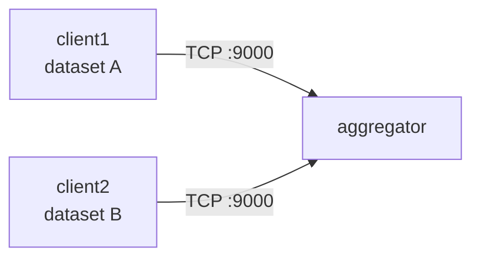

# mini-federado

A minimal client-aggregator system built with Docker Compose, demonstrating
the core infrastructure patterns behind federated learning: isolated nodes
with their own local data, communicating with a central aggregator without
ever sharing raw data.

## What this demonstrates

- Multi-service orchestration with Docker Compose
- Service discovery via Docker's internal DNS (containers reach each other
  by service name, not IP)
- Per-node data isolation using bind-mounted volumes
- Parameterizing identical images via environment variables
- Correct handling of Python's output buffering in long-running containers

## Architecture



Each client reads a local dataset description from its own mounted volume,
connects to the aggregator over a plain TCP socket, sends an identifying
message, and exits. The aggregator listens indefinitely and logs each
message it receives.

In a real federated learning system, the client would send trained model
parameters instead of a text message, and the aggregator would combine
them rather than just logging them.

## Running it

```bash
docker compose up --build
```

Expected output:

```
aggregator-1  | Aggregator waiting for connections...
aggregator-1  | Received message: Hello from client1, dataset: This is dataset A
client1-1     | client1: message sent
aggregator-1  | Received message: Hello from client2, dataset: This is dataset B
client2-1     | client2: message sent
```

Message order between client1 and client2 is not guaranteed — both start
concurrently and whichever connects first logs first.

## Design decisions and limitations

- **Plain TCP instead of HTTP**: kept deliberately low-level to make the
  client-server mechanics explicit.
- **Fixed `time.sleep(3)` on the client**: a naive workaround for container
  startup ordering.
- **`PYTHONUNBUFFERED=1`**: without it, Python buffers stdout in non-interactive
  environments, so logs from a long-running process never flush to `docker logs` 
  until the process exits.
- **No persistence**: the aggregator only prints received messages; it
  doesn't store or aggregate anything.
- **No security**: no TLS, no authentication between nodes. Out of scope
  for this project.
